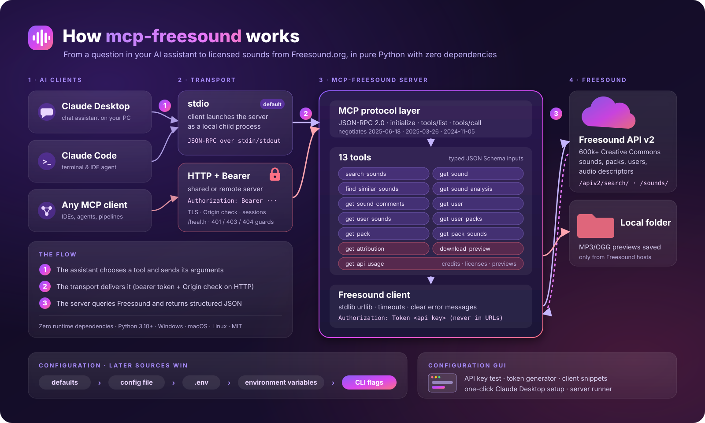

<p align="center">
  
</p>

<p align="center">
  <b>Search, explore and credit Freesound.org audio from any AI assistant.</b><br>
  A pure-Python, zero-dependency Model Context Protocol server, over stdio or HTTP with a bearer token.
</p>

<p align="center">
  
  
  
  
</p>

<p align="center">
  <a href="README-it.md">🇮🇹 Leggi in italiano</a>
</p>

---

## What is this?

**mcp-freesound** is a [Model Context Protocol](https://modelcontextprotocol.io) (MCP) server
that connects AI assistants such as Claude Desktop, Claude Code and MCP-enabled IDEs or agents to
[Freesound.org](https://freesound.org), the collaborative database of more than 600,000
Creative Commons sounds.

Once connected, you can ask your assistant things like *"find three short, CC0 thunder sounds
for a storm scene and give me the credits"*. The assistant searches Freesound, compares
results, checks licenses, downloads previews and writes the attribution text for you.

It is a complete reimplementation of
[johnkimdw/freesound-mcp-server](https://github.com/johnkimdw/freesound-mcp-server) in plain
Python. The original has one tool. This version has thirteen, an authenticated HTTP transport and a
configuration GUI.

## Why is it needed?

- **Finding the right sound is slow.** Browsing, filtering, listening and checking licenses by
  hand takes time. An assistant can run many searches and narrow them down for you.
- **Licenses are easy to get wrong.** Freesound mixes CC0, CC BY and CC BY-NC sounds.
  `get_attribution` tells you which sounds need credit and which allow commercial use, and
  writes the credit lines.
- **AI assistants can't reach Freesound on their own.** MCP is the standard way to give them
  that access safely, through tools with typed inputs.
- **No dependency problems.** The server runs on any Python 3.10+ with nothing to install
  (`python mcp-freesound.py`). It works in locked-down environments, offline mirrors and
  minimal containers.
- **Local or shared.** Use stdio for a personal desktop setup. Use the HTTP transport, protected
  by a bearer token, to share one server with a team or to run it on another machine.

## When to use it

| Use it when you... | Prefer something else when you... |
|---|---|
| edit video or podcasts and need sound effects, ambiences or loops | need full-quality original files in bulk (that requires Freesound OAuth2, see [Disclaimers](#disclaimers)) |
| want an assistant to search, compare and shortlist sounds | need to upload, rate or comment on sounds (write operations are not exposed) |
| need correct attribution and license checks before publishing | need guaranteed legal advice on licensing |
| build agents or pipelines that pick audio automatically | need a high-volume production integration (respect Freesound's API limits and terms) |
| research audio descriptors (bpm, key, loudness) for many sounds | |

## Features

- **13 tools**: search with filters/sorting, sound details, similar sounds, audio analysis,
  comments, users, packs, attribution builder, preview download, API usage.
- **Two transports**: `stdio` (default) and **Streamable HTTP** protected by a **bearer token**,
  with optional TLS, `Origin` checks (DNS-rebinding protection), sessions and a `/health` probe.
- **Configuration GUI** (Tkinter): API key test, token generator, ready-to-copy client
  snippets, one-click Claude Desktop setup, built-in server runner with live log.
- **Zero runtime dependencies**: standard library only, Python 3.10-3.13, Windows/macOS/Linux.
- **Safe by default**: the API key is sent in a header and never in URLs; HTTP binds to
  `127.0.0.1`; the server refuses to start HTTP without a token; downloads are limited to
  Freesound hosts and one folder.
- **Backwards compatible**: `search_sounds` accepts the same arguments and returns the same
  shape as the original server.

## How it works

<p align="center">
  
</p>

More detail in [docs/architecture.md](docs/architecture.md).

---

## Quick start

```bash
git clone https://github.com/jumpnotequal/mcp-freesound.git
cd mcp-freesound
python mcp-freesound.py gui        # paste your API key, click "Test key", then "Save"
python mcp-freesound.py check      # optional: verify the key from the command line
```

Then, in the GUI's **Client setup** tab, click **Add to Claude Desktop config** (a backup of the
existing file is kept) and restart Claude Desktop. Done.

## Installation

You need **Python 3.10+**. Tkinter is needed for the GUI only. It ships with the python.org
installers; on Debian/Ubuntu install `python3-tk`.

**Option A: run from a clone (no installation)**

```bash
git clone https://github.com/jumpnotequal/mcp-freesound.git
python mcp-freesound/mcp-freesound.py --help
```

**Option B: install with pip** (adds the `mcp-freesound` and `mcp-freesound-gui` commands)

```bash
pip install git+https://github.com/jumpnotequal/mcp-freesound.git
mcp-freesound --help
```

### Get a Freesound API key

1. Create a free account on [freesound.org](https://freesound.org).
2. Request an API credential at <https://freesound.org/apiv2/apply/>.
3. Copy the **Client secret/Api key** value. That is your `FREESOUND_API_KEY`.

## Configuration

Settings are read from these sources. Each one overrides the one before it:

```text
defaults  <  config file  <  ./.env  <  environment variables  <  CLI flags
```

The **GUI** (`mcp-freesound gui`) edits the config file:

| OS | Config file |
|---|---|
| Windows | `%APPDATA%\mcp-freesound\config.json` |
| macOS | `~/Library/Application Support/mcp-freesound/config.json` |
| Linux | `~/.config/mcp-freesound/config.json` |

| Setting | Env variable | CLI flag | Default |
|---|---|---|---|
| Freesound API key | `FREESOUND_API_KEY` | `--api-key` | (required) |
| Transport | `MCP_FREESOUND_TRANSPORT` | `--transport` | `stdio` |
| HTTP host | `MCP_FREESOUND_HOST` | `--host` | `127.0.0.1` |
| HTTP port | `MCP_FREESOUND_PORT` | `--port` | `8000` |
| HTTP path | `MCP_FREESOUND_PATH` | `--path` | `/mcp` |
| Bearer token | `MCP_FREESOUND_AUTH_TOKEN` | `--auth-token` | (required for HTTP) |
| Extra allowed origins | `MCP_FREESOUND_ALLOWED_ORIGINS` | `--allowed-origin` | localhost only |
| TLS certificate / key | `MCP_FREESOUND_TLS_CERT` / `_TLS_KEY` | `--tls-cert` / `--tls-key` | off |
| Download folder | `MCP_FREESOUND_DOWNLOAD_DIR` | `--download-dir` | `~/Downloads/freesound` |
| Allow `download_preview` | `MCP_FREESOUND_ALLOW_DOWNLOADS` | - | `true` |
| Request timeout (s) | `MCP_FREESOUND_TIMEOUT` | - | `30` |
| Log level | `MCP_FREESOUND_LOG_LEVEL` | `--log-level` | `INFO` |
| Config file path | `MCP_FREESOUND_CONFIG` | `--config` | per-OS path above |

See [examples/.env.example](examples/.env.example) and
[examples/config.example.json](examples/config.example.json).

> **Windows: environment variables always reach the server.** Some MCP clients (Claude Desktop
> among them) start servers with a reduced environment that leaves out your own variables.
> When a variable from the table is missing from the process, mcp-freesound reads it straight
> from the Windows registry: user variables first, then system variables. Set
> `FREESOUND_API_KEY` once in *Settings → System → About → Advanced system settings →
> Environment Variables* (or `setx FREESOUND_API_KEY your_key`) and you don't need to put the
> key in any client config. On macOS/Linux, use the client's `env` block or the GUI.

## Transports

### stdio (default)

The MCP client starts the server as a child process and talks to it over stdin/stdout.
This is the best fit for a personal desktop setup.

```bash
mcp-freesound                       # same as: mcp-freesound serve --transport stdio
```

### HTTP with bearer token

The server listens on a URL. Every request must carry `Authorization: Bearer <token>`.

```bash
mcp-freesound token                                     # generate a strong random token
mcp-freesound serve --transport http --auth-token <token>
# -> http://127.0.0.1:8000/mcp   (health check: http://127.0.0.1:8000/health)
```

To reach it from other machines, bind to a public interface **and enable TLS**, or put it
behind a TLS reverse proxy:

```bash
mcp-freesound serve --transport http --host 0.0.0.0 --port 8443 \
  --auth-token <token> --tls-cert cert.pem --tls-key key.pem
```

`--insecure-no-auth` turns authentication off. Use it only for local tests.

## Client setup

**Claude Desktop, stdio** (`claude_desktop_config.json`, or use the GUI button):

```json
{
  "mcpServers": {
    "freesound": {
      "command": "mcp-freesound",
      "args": ["serve", "--transport", "stdio"],
      "env": { "FREESOUND_API_KEY": "your_freesound_api_key" }
    }
  }
}
```

Running from a clone instead of pip? Use `"command": "python"` and
`"args": ["/path/to/mcp-freesound/mcp-freesound.py", "serve"]`.

Already have `FREESOUND_API_KEY` as a Windows environment variable, or saved the key with the
GUI? Then leave out the `env` block entirely:

```json
{
  "mcpServers": {
    "freesound": {
      "command": "C:/Python/python.exe",
      "args": ["C:/path/to/mcp-freesound/mcp-freesound.py", "serve", "--transport", "stdio"]
    }
  }
}
```

**Claude Code**

```bash
claude mcp add freesound -e FREESOUND_API_KEY=your_key -- mcp-freesound serve --transport stdio
claude mcp add --transport http freesound http://127.0.0.1:8000/mcp --header "Authorization: Bearer <token>"
```

**Any client that supports Streamable HTTP**: see [examples/http_client.json](examples/http_client.json).
**Claude Desktop to a remote HTTP server**: see [examples/claude_desktop_http_bridge.json](examples/claude_desktop_http_bridge.json).

**Debug with the MCP Inspector**

```bash
npx @modelcontextprotocol/inspector python mcp-freesound.py
```

## Tools

| Tool | What it does |
|---|---|
| `search_sounds` | Text search with Freesound filters (`duration:[0 TO 10] license:"Creative Commons 0"`), sorting and paging |
| `get_sound` | Full details: sample rate, bit depth, channels, size, pack, geotag, ratings, downloads, previews, waveform |
| `find_similar_sounds` | Acoustically similar sounds |
| `get_sound_analysis` | Audio descriptors such as bpm, key, loudness |
| `get_sound_comments` | Comments on a sound |
| `get_user` / `get_user_sounds` / `get_user_packs` | Explore an uploader |
| `get_pack` / `get_pack_sounds` | Explore a pack |
| `get_attribution` | Credit lines plus "attribution required?" and "commercial use allowed?" for up to 50 sounds |
| `download_preview` | Save the MP3/OGG preview to the download folder |
| `get_api_usage` | How many API requests your key has used |

Full reference with arguments and output: [docs/tools.md](docs/tools.md).

### Example prompts

- "Find thunder sound effects for a storm scene, under 20 seconds, CC0 only."
- "Search ambient city sounds sorted by rating and download the best two previews."
- "Show me sounds similar to 2523 and tell me their bpm."
- "I used sounds 2523, 41529 and 9834 in my video. Write the credits and tell me if I can monetize it."
- "Who uploaded sound 2523, and what other packs has that user published?"

## CLI reference

```text
mcp-freesound [serve] [--transport stdio|http] [--host H] [--port P] [--path /mcp]
                      [--auth-token T] [--allowed-origin O]... [--tls-cert F --tls-key F]
                      [--insecure-no-auth]
mcp-freesound gui                       open the configuration GUI (also: mcp-freesound-gui)
mcp-freesound token                     print a new random bearer token
mcp-freesound config [--show-secrets]   print the effective configuration
mcp-freesound check                     verify the Freesound API key
global options: --config FILE --api-key KEY --download-dir DIR --log-level LEVEL --version
```

`python mcp-freesound.py ...` accepts exactly the same arguments.

## Project structure

```text
mcp-freesound.py      the server launcher (runs without installation)
src/mcp_freesound/    core package: protocol, tools, Freesound client, transports, GUI
docs/                 architecture and tool reference
examples/             client configs, .env and config file templates, curl calls
assets/               logo and infographic (SVG + PNG)
test/                 local tests and smoke tests (outputs in test/_out, git-ignored)
publishme.bat         creates the GitHub repository and pushes it (Windows)
```

## Development

```bash
python -m venv test/.venv
test/.venv/Scripts/python -m pip install pytest ruff build   # Linux/macOS: test/.venv/bin/python
test/.venv/Scripts/python -m pytest -p no:cacheprovider --basetemp=test/_out/pytest test
test/.venv/Scripts/python test/smoke_http.py                 # real server over HTTP + bearer token
test/.venv/Scripts/ruff check . && test/.venv/Scripts/ruff format --check .
```

All tests, virtualenvs and outputs stay inside `test/`. Details in [test/README.md](test/README.md).

Contributions are welcome. See [CONTRIBUTING.md](CONTRIBUTING.md) and [SECURITY.md](SECURITY.md).

## Disclaimers

- **Not affiliated with Freesound.** Freesound is a project of the Music Technology Group,
  Universitat Pompeu Fabra. This is an independent, unofficial client.
- **You are responsible for license compliance.** Every sound has its own license (CC0, CC BY,
  CC BY-NC...). The license analysis and credit text produced by `get_attribution` are a
  convenience, not legal advice. Always check the sound page before you publish.
- **API terms and limits.** Your use of the Freesound API is governed by the
  [Freesound API terms of use](https://freesound.org/help/tos_api/). Standard keys have rate
  limits and may be limited to non-commercial use. Check the current terms, and contact
  Freesound for commercial or high-volume use.
- **Previews only.** `download_preview` saves the lossy preview files. Downloading the original
  files requires OAuth2 user authentication, which this server does not implement.
- **Security.** Treat your API key and bearer token as passwords. Do not expose the HTTP
  transport to a network without TLS. See [SECURITY.md](SECURITY.md).
- **AI output.** Assistants can misunderstand results. Check sound choices and credits before
  you rely on them.
- Provided "as is", without warranty of any kind (see [LICENSE](LICENSE)).

## Credits

- Original idea and first implementation:
  [johnkimdw/freesound-mcp-server](https://github.com/johnkimdw/freesound-mcp-server) (MIT).
- Sounds and API: [Freesound.org](https://freesound.org) by the MTG, UPF.
- Protocol: [Model Context Protocol](https://modelcontextprotocol.io).

## License

[MIT](LICENSE). The audio you find through this server is subject to each sound's own license.
